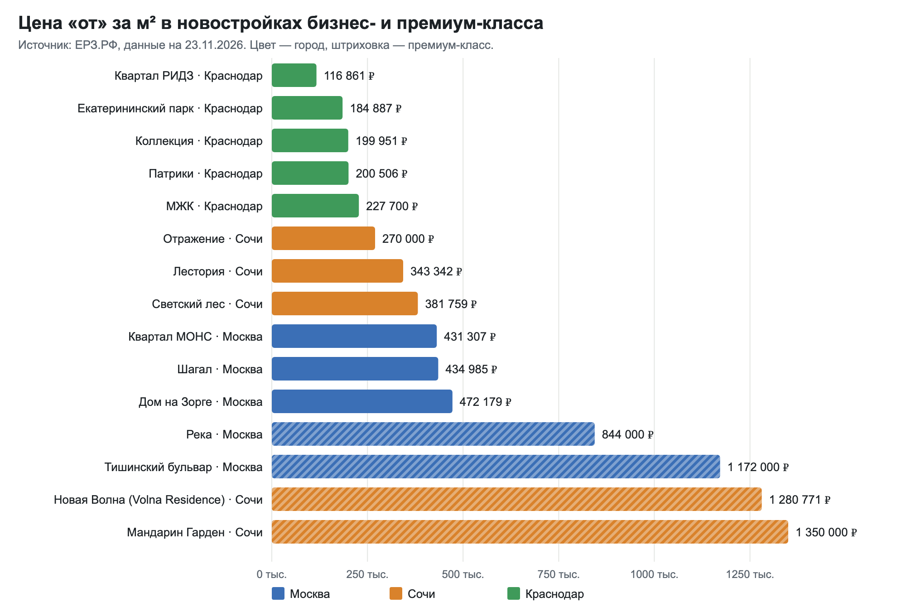

# AI-исследование рынка новостроек: Сочи, Москва, Краснодар

Тестовое задание на стажировку «Инженер по ИИ / AI-архитектор». Выполнены обе части трека (**А «Код»** и **Б «Бизнес»**) и описание работы с ИИ.

| Часть | Где смотреть |
|---|---|
| 1. Таблица, график, выводы | ниже на этой странице · [CSV для Google Таблиц](data/zhk.csv) |
| 2А. Подборщик ЖК (код) | [открыть в браузере](https://valievandrey38-png.github.io/novostroyki-ai/podbor/) · [код страницы](podbor/podbor.js) · [Python-скрипт](podbor/podbor.py) · [скриншоты](screenshots/) |
| 2Б. AI-инструмент и сценарии роликов | [trek-b-biznes.md](trek-b-biznes.md) |
| 3. Промпты, ошибки нейросети, время | [rabota-s-ii.md](rabota-s-ii.md) |

## Часть 1. Данные

15 жилых комплексов бизнес- и премиум-класса, по 5 в каждом городе. Третий город — **Краснодар**: это ближайший к Сочи крупный рынок и главный «конкурент» Сочи для покупателей, которые хотят жить на юге.

**Источник.** Реестр новостроек [ЕРЗ.РФ](https://erzrf.ru): цена «от» за м², срок сдачи, застройщик и класс взяты из реестра, у каждой строки ссылка на карточку ЖК. Класс «премиум» в реестре называется «элитный». Данные на **23.11.2026**.

<!-- TABLE -->
| Город | ЖК | Застройщик | Район | Класс | Цена от, ₽/м² | Срок сдачи | Источник |
|---|---|---|---|---|---:|---|---|
| Сочи | Светский лес | ГК ТОЧНО | Центральный | бизнес | 381 759 | II кв. 2028 | [ЕРЗ](https://erzrf.ru/novostroyki/zhk-svetskij-les-24975745001) |
| Сочи | Лестория <sup title="на ЕРЗ карточка подписана старым названием «Искра»">*</sup> | Неометрия | Хостинский | бизнес | 343 342 | II кв. 2026 | [ЕРЗ](https://erzrf.ru/novostroyki/zhk-iskra-9896370001) |
| Сочи | Отражение <sup title="на ЕРЗ карточка подписана старым названием «Эльсинор»">*</sup> | ГК НОСТА | Центральный | бизнес | 270 000 | II кв. 2026 | [ЕРЗ](https://erzrf.ru/novostroyki/zhk-elsinor-6866730001) |
| Сочи | Новая Волна (Volna Residence) <sup title="на ЕРЗ класс «элитный»">*</sup> | СЗ Файв Старс | Адлерский | премиум | 1 280 771 | II кв. 2028 | [ЕРЗ](https://erzrf.ru/novostroyki/zhk-novaja-volna-volna-residence-21804261001) |
| Сочи | Мандарин Гарден <sup title="на ЕРЗ класс «элитный»">*</sup> | СЗ Солнечный луч | Адлерский | премиум | 1 350 000 | I кв. 2030 | [ЕРЗ](https://erzrf.ru/novostroyki/zhk-mandarin-garden-29798610001) |
| Москва | Дом на Зорге | ГК А101 | Хорошёвский | бизнес | 472 179 | II кв. 2026 | [ЕРЗ](https://erzrf.ru/novostroyki/zhk-dom-na-zorge-23590436001) |
| Москва | Квартал МОНС | Брусника | Бутырский | бизнес | 431 307 | III кв. 2027 | [ЕРЗ](https://erzrf.ru/novostroyki/zhk-kvartal-mons-24915484001) |
| Москва | Шагал <sup title="срок первой очереди по ЕРЗ уже прошёл, продажи в ЖК продолжаются">*</sup> | Группа Эталон | Даниловский | бизнес | 434 985 | от IV кв. 2023 (строится очередями) | [ЕРЗ](https://erzrf.ru/novostroyki/zhk-shagal-18116279001) |
| Москва | Тишинский бульвар <sup title="на ЕРЗ класс «элитный»">*</sup> | Sminex | Пресненский | премиум | 1 172 000 | III кв. 2027 | [ЕРЗ](https://erzrf.ru/novostroyki/zhk-tishinskij-bulvar-24981984001) |
| Москва | Река <sup title="на ЕРЗ класс «элитный»; срок первой очереди уже прошёл, продажи продолжаются">*</sup> | ДОНСТРОЙ | Раменки | премиум | 844 000 | от IV кв. 2021 (строится очередями) | [ЕРЗ](https://erzrf.ru/novostroyki/zhk-reka-11650950001) |
| Краснодар | Патрики <sup title="район на ЕРЗ не указан, взята локация из адреса">*</sup> | ГК ТОЧНО | ул. Сормовская / Старокубанская | бизнес | 200 506 | IV кв. 2025 | [ЕРЗ](https://erzrf.ru/novostroyki/zhk-patriki-22596911001) |
| Краснодар | Коллекция <sup title="на ЕРЗ карточка подписана «Западный обход»; часть агрегаторов относит ЖК к комфорт-классу">*</sup> | ГК НВМ | Западный обход | бизнес | 199 951 | I кв. 2027 | [ЕРЗ](https://erzrf.ru/novostroyki/zhk-zapadnyj-obkhod-25313812001), [район](https://myurist.online/realty/krasnodar/zhk-kollektsiya/) |
| Краснодар | МЖК <sup title="на ЕРЗ карточка подписана «Дом по ул. Ефремова»">*</sup> | СЗ Новастрой | МЖК (пр-д Владимира Ефремова) | бизнес | 227 700 | IV кв. 2029 | [ЕРЗ](https://erzrf.ru/novostroyki/zhk-dom-po-ul-efremova-29920272001) |
| Краснодар | Квартал РИДЗ | DOGMA | ул. Пригородная, у Ближнего Западного обхода | бизнес | 116 861 | III кв. 2028 | [ЕРЗ](https://erzrf.ru/novostroyki/zhk-kvartal-reeds-27646318001), [район](https://www.novostroy-m.ru/baza/jk_ridz) |
| Краснодар | Екатерининский парк <sup title="срок по ЕРЗ уже прошёл, квартиры в продаже">*</sup> | ГК ЕкатеринодарИнвест-Строй | Фестивальный | бизнес | 184 887 | IV кв. 2024 | [ЕРЗ](https://erzrf.ru/novostroyki/zhk-ekaterininskij-park-18801521001), [район](https://realty.yandex.ru/krasnodar/kupit/kvartira/studiya/zhk-ekaterininskij-park-2951999/s-panoramnymi-oknami/) |

<sup>*</sup> Примечания:
- **Лестория:** на ЕРЗ карточка подписана старым названием «Искра»
- **Отражение:** на ЕРЗ карточка подписана старым названием «Эльсинор»
- **Новая Волна (Volna Residence):** на ЕРЗ класс «элитный»
- **Мандарин Гарден:** на ЕРЗ класс «элитный»
- **Шагал:** срок первой очереди по ЕРЗ уже прошёл, продажи в ЖК продолжаются
- **Тишинский бульвар:** на ЕРЗ класс «элитный»
- **Река:** на ЕРЗ класс «элитный»; срок первой очереди уже прошёл, продажи продолжаются
- **Патрики:** район на ЕРЗ не указан, взята локация из адреса
- **Коллекция:** на ЕРЗ карточка подписана «Западный обход»; часть агрегаторов относит ЖК к комфорт-классу
- **МЖК:** на ЕРЗ карточка подписана «Дом по ул. Ефремова»
- **Екатерининский парк:** срок по ЕРЗ уже прошёл, квартиры в продаже
<!-- /TABLE -->

## График



## Выводы

1. **Москва дороже всех в бизнес-классе.** Медиана цены «от» — 435 тыс. ₽/м². Сочи на 21% дешевле (343 тыс.), Краснодар — в 2,2 раза дешевле (200 тыс.).
2. **В премиуме Сочи дороже Москвы — это удивило больше всего.** Премиальные ЖК у моря в Адлере стартуют от 1,28–1,35 млн ₽/м², а московские из выборки — от 0,84 до 1,17 млн. Море и нехватка земли у берега стоят дороже, чем центр столицы.
3. **В Сочи самый большой разрыв между классами.** Самый дешёвый ЖК выборки (Отражение, 270 тыс.) и самый дорогой (Мандарин Гарден, 1,35 млн) отличаются в 5 раз. В Москве — в 2,7 раза, в Краснодаре — в 1,9 раза. Сочи — это фактически два разных рынка.
4. **За премиум в Сочи платят и ожиданием.** Оба премиальных ЖК Сочи сдаются в 2028–2030 годах: покупатель платит самую высокую цену за метр и ждёт ключи 2–4 года.
5. **Ограничение данных.** Цена «от» — это самая дешёвая квартира в продаже, а не средняя; по 5 ЖК на город — срез, а не полная картина рынка. Для решений я бы смотрел среднюю цену по всем лотам и динамику за несколько месяцев.

## Как пересобрать

```bash
python3 build.py              # из data/zhk.json → CSV, график, таблица в README, данные подборщика
python3 podbor/podbor.py Сочи 25 60
```
